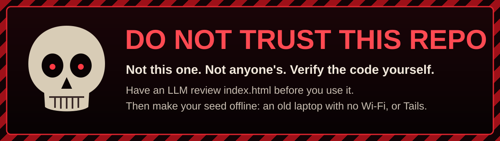

# How it works

*The Reaper's Ledger, step by step.*

<p align="center"></p>

Read [Before anything else: verify, then go offline](README.md#before-anything-else-verify-then-go-offline) in the README before you use the page.

Everything below happens inside `index.html`. There is no server, no library download and no build step. The page's Content-Security-Policy (`connect-src 'none'`) blocks network requests, and it loads nothing from outside the file.

```
dice rolls ──► entropy (128 or 256 bits) ──► + checksum ──► 11-bit numbers ──► words
             (compatibility type)          (BIP39)          (BIP39)          (BIP39 wordlist)
```

Only the first arrow differs between the compatibility types. Everything from entropy onward is standard BIP39.

## 1. The weight of a bone: how much randomness a roll carries

A fair six-sided die has six equally likely results, so one roll carries log₂ 6 ≈ 2.585 bits. The counter under the progress bar shows rolls × 2.585, capped at the size of the seed, because a 12-word phrase can never hold more than 128 bits however many rolls go in.

| Rolls | Bits |
|---|---|
| 50 | 129.2 |
| 99 | 255.9 |
| 100 | 258.5 |
| 256 (maximum) | 661.8 |

## 2. Two rites: why there are compatibility types

BIP39 defines how entropy becomes words. It says nothing about how dice become entropy, so every wallet invented its own way. The same rolls therefore give a different phrase on each device. If you want to check a wallet's dice entry, or rebuild a phrase from your written rolls later, the page has to use exactly the same method as the device.

Both types use the same core idea: put the rolls in a text string and hash it with SHA-256. Hashing turns a string of any length into 256 bits that carry all the randomness of the rolls, up to 256 bits. Changing any roll, or adding one, changes the whole result.

### Keystone / Ian Coleman

1. Write the rolls as a string, one digit per roll, and replace every `6` with `0`: rolls `1 2 3 4 5 6` become `"123450"`.
2. Hash that string with SHA-256.
3. Keep the first 16 bytes for 12 words or all 32 bytes for 24 words.

Replacing 6 with 0 makes the digits 0–5, the way base-6 numbers are written. It swaps one symbol for another, so it neither adds nor removes randomness.

Where it comes from:

- **Keystone** firmware, `ConfirmHandler` in `gui_dice_rolls_widgets.c` and `ModelGenerateEntropyWithDiceRolls` in `gui_model.c`. It allows 12 or 24 words only, needs at least 50 or 100 rolls, and takes at most 256. Every roll entered is hashed.
- **Ian Coleman's BIP39 tool**, `setMnemonicFromEntropy` in `src/js/index.js`. With Dice entropy and a mnemonic length of 12 or 24 words it does exactly the same: 6 becomes 0, SHA-256, keep the first 128 or 256 bits. Two things to watch on his page:
  - His default length, "Use Raw Entropy", is a different method that converts each roll to bits directly; it won't match. Select 12 or 24 words.
  - His page guesses the entropy type from what you type. Check that it shows dice; a string of only 1s, for example, is read as binary.

### Coldcard / SeedSigner

1. Write the rolls as a string, one digit per roll, exactly as rolled: `1 2 3 4 5 6` becomes `"123456"`.
2. Hash that string with SHA-256.
3. Keep the first 16 bytes for 12 words or all 32 bytes for 24 words.

Where it comes from:

- **Coldcard** firmware, the dice-only seed (`new_from_dice` / `add_dice_rolls` in `shared/seed.py`), and its check script `docs/rolls.py`. At least 50 rolls for 12 words and 99 for 24. Coldcard also refuses a set of rolls where one number makes up more than 30% of them; this page does not apply that rule.
  - Coldcard's normal new-wallet flow with dice rolls mixes the rolls with the device's own random numbers. That phrase can't be reproduced from the rolls, by design, so it can't be checked here.
- **SeedSigner**, `generate_mnemonic_from_dice` in `src/seedsigner/helpers/mnemonic_generation.py`. Its dice screen takes 50 rolls for 12 words or 99 for 24, so enter exactly that many here to match it.

99 rolls carry 255.9 bits, a fraction short of 256. That's Coldcard's and SeedSigner's choice; the page follows it so the phrases match.

### Roll limits on this page

| Type | 12 words | 24 words | Maximum |
|---|---|---|---|
| Keystone / Ian Coleman | 50+ | 100+ | 256 |
| Coldcard / SeedSigner | 50+ | 99+ | 256 |

The maximum is Keystone's limit, used for both types. Switching type or length re-derives the phrase from the rolls already entered.

## 3. From bones to words: entropy to BIP39

1. **Checksum.** Hash the entropy with SHA-256 and take the first ENT ÷ 32 bits: 4 bits for 128-bit entropy, 8 bits for 256-bit.
2. **Join** entropy and checksum: 132 bits for 12 words, 264 bits for 24.
3. **Split** into 11-bit numbers, most significant first. Each is 0–2047, a position in the BIP39 English wordlist.

The checksum is why a wallet usually rejects a phrase with one wrong word: the last word has to agree with the rest. It is only 4 bits for 12 words and 8 bits for 24, so a wrong word still slips through about 1 time in 16 or 1 in 256, and the wallet then opens a different, empty wallet. Check your written words against the screen before you reap.

### Worked example: 60 rolls, Keystone / Ian Coleman, 12 words

- Rolls: `123456` repeated, 60 rolls.
- String hashed: `123450` repeated (each 6 written as 0).
- SHA-256: `b5740b72a7d0ce9f1df343d925dc2e89a0d55dfd8a34f3f04747a622fbee7eb6`
- Entropy (first 16 bytes): `b5740b72a7d0ce9f1df343d925dc2e89`
- SHA-256 of the entropy starts with `59`, binary `0101 1001`, so the checksum is `0101`.
- The 132 bits split into 12 numbers:

| # | 11 bits | Index | Word no. | Word |
|---|---|---|---|---|
| 1 | 10110101011 | 1451 | 1452 | rely |
| 2 | 10100000010 | 1282 | 1283 | park |
| 3 | 11011100101 | 1765 | 1766 | syrup |
| 4 | 01001111101 | 637 | 638 | exile |
| 5 | 00001100111 | 103 | 104 | artefact |
| 6 | 01001111100 | 636 | 637 | exhibit |
| 7 | 01110111110 | 958 | 959 | jelly |
| 8 | 01101000011 | 835 | 836 | half |
| 9 | 11011001001 | 1737 | 1738 | summer |
| 10 | 00101110111 | 375 | 376 | confirm |
| 11 | 00001011101 | 93 | 94 | arm |
| 12 | 00010010101 | 149 | 150 | bargain |

### More examples to check against

| Type | Rolls | Words |
|---|---|---|
| Keystone / Ian Coleman | `123456` repeated, 105 rolls | when shield swamp ordinary essence crater solid tiger aisle column jump laugh chicken bleak divert viable state globe stomach average question icon flee settle |
| Coldcard / SeedSigner | `123456` repeated, 99 rolls | few educate sugar bless boring random strategy waste mutual cargo type hawk prefer denial scan abstract filter extend dignity balcony dust unusual correct bubble |
| Coldcard / SeedSigner | `123456` repeated, 60 rolls, 12 words | better proud crime leopard ice empty olive glance include citizen where spot |

The first was confirmed on a Keystone device. The Coldcard 24-word example can be reproduced with Coldcard's own script: `echo <rolls> | python3 docs/rolls.py`.

## 4. Bound in steel: the steel plate guide

A 12-column steel plate stores each word as a number written in binary. The columns are worth 2048, 1024, 512, 256, 128, 64, 32, 16, 8, 4, 2 and 1. You punch the columns that add up to the word's number.

- **Word numbers are 1–2048**, the word's position in the numbered BIP39 wordlist (the 11-bit index plus one). Plates are printed for that convention. "abandon" is 1 and punches only the 1 column; "zoo" is 2048 and is the only word that punches the 2048 column.
- **Each row** shows the word, its number, a filled dot on every column to punch, and the punched values written out. For "when", number 2002: `1024+512+256+128+64+16+2`. Add them up before stamping and again on the finished plate.
- **Column dividers** split the 12 columns into 2048–512, 256–32 and 16–1, so your eye doesn't slip a column while stamping.
- **"Print guide"** prints only the table, black on white. A printout, and the printer's memory, hold your full seed: destroy the paper after stamping.

## 5. What the reaper keeps: what the page does with your secrets

- **Nothing leaves the page.** No network requests are possible (see the top of this file). The rolls, phrase and entropy live in variables inside the page's script, not on `window`.
- **Nothing is cleared on a timer.** The phrase stays on screen until you're done writing it down.
- **"Reap everything"** asks for confirmation, then clears the rolls, phrase, entropy and steel guide, and overwrites the clipboard. "Clear rolls" clears only the rolls. Closing the tab also clears everything.
- **Clipboard.** 12 seconds after you copy the phrase or hex, the page overwrites the clipboard with 32 random letters. Browsers block clipboard writes while the page is in the background; if that happens the page says so and overwrites the clipboard when you return to it. Operating-system clipboard history and clipboard sync keep their own copies, and no web page can reach those. The safest copy is no copy.
- **Internal check on load.** The page checks the wordlist (2048 words, in order, matching its SHA-256 hash), its SHA-256 against two standard test values, its BIP39 code against the four official BIP39 test vectors, and that steel-plate dots add up. Nothing is shown when it passes. If anything fails, every control is disabled and a warning lists what failed.
- **SHA-256** comes from the browser's built-in Web Crypto. There is no home-made fallback; a browser without Web Crypto fails the internal check and the page locks.

## 6. What it can't save you from: limits

- The page can't tell whether your dice are fair or whether you entered what actually landed.
- It can't wipe OS clipboard history, screenshots, a printer's memory or anything else outside the page.
- It has been tested in Chrome and Firefox. Safari has not been tested.

## 7. Check the ledger yourself: verification

- Reproduce the examples in section 3 on the page, and with the wallets or tools you use.
- Recompute any phrase outside the page. For example in Python:

  ```python
  import hashlib
  from mnemonic import Mnemonic   # pip install mnemonic (Trezor's BIP39 reference library)

  rolls = "123456" * 10           # your rolls
  keystone = hashlib.sha256(rolls.replace("6", "0").encode()).digest()[:16]
  coldcard = hashlib.sha256(rolls.encode()).digest()[:16]   # [:32] for 24 words
  print(Mnemonic("english").to_mnemonic(keystone))
  print(Mnemonic("english").to_mnemonic(coldcard))
  ```

- Read the page source. The roll-to-entropy code is the two short functions `keystoneRollsToEntropy` and `coldcardRollsToEntropy`; BIP39 is `entropyToMnemonic`.
- Check `index.html` against `index.html.sha256` before use.

## References

- BIP39 specification: <https://github.com/bitcoin/bips/blob/master/bip-0039.mediawiki>
- Trezor BIP39 reference library and test vectors: <https://github.com/trezor/python-mnemonic>
- Ian Coleman BIP39 tool: <https://github.com/iancoleman/bip39>
- Coldcard firmware: <https://github.com/Coldcard/firmware>
- SeedSigner: <https://github.com/SeedSigner/seedsigner>
