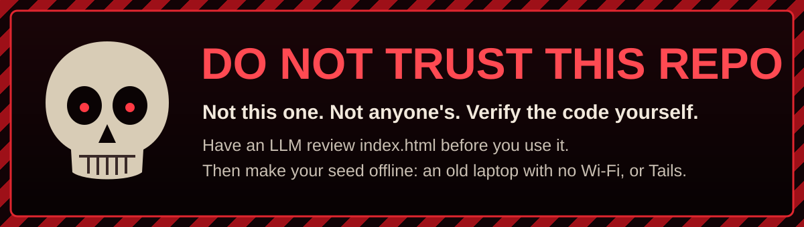
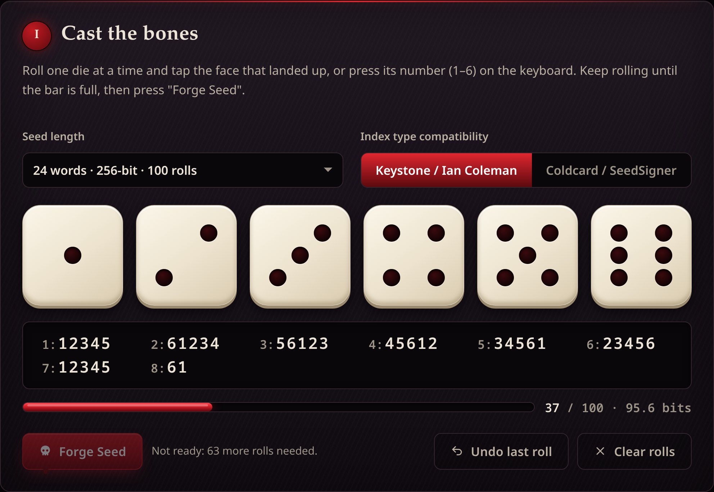
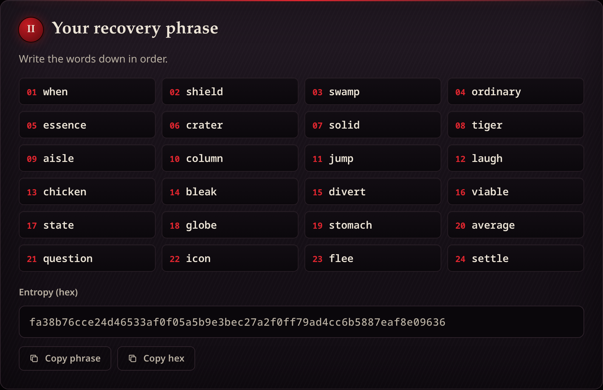
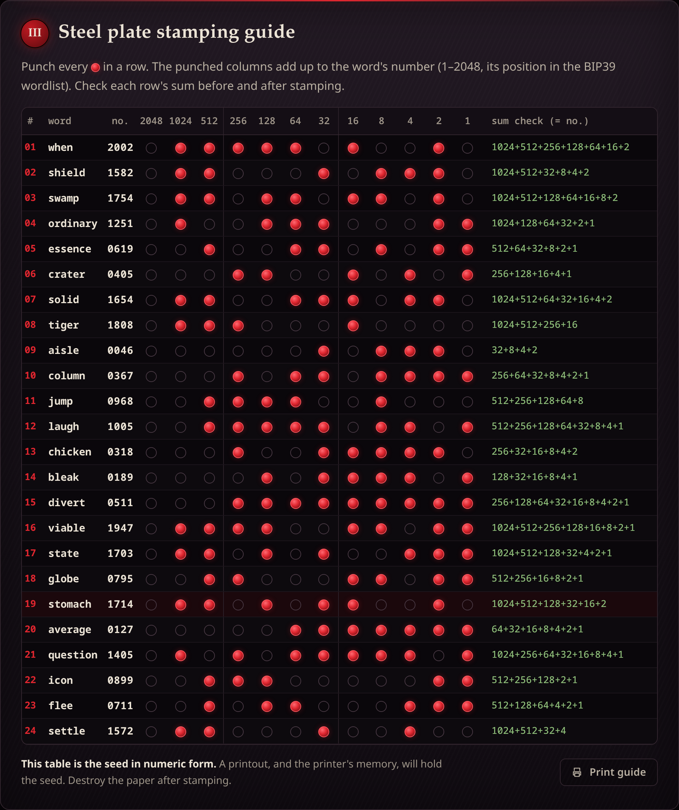
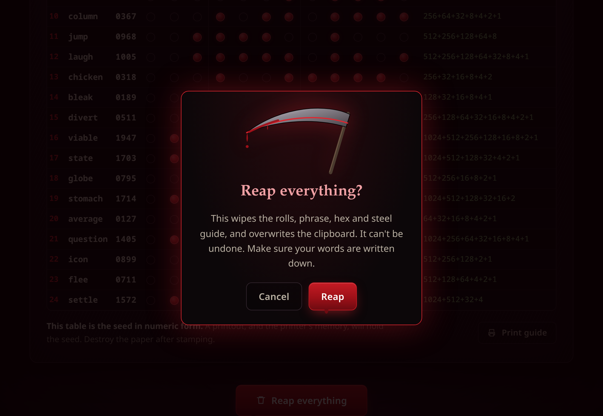

# The Reaper's Ledger

*dice in · phrase out · nothing leaves the page*

One HTML file that turns physical dice rolls into a BIP39 recovery phrase, offline.

## Before anything else: verify, then go offline

A recovery phrase is the key to everything in the wallet. Whoever wrote the page that made it could have hidden a way to leak it. That includes this page. Don't trust it because it's on GitHub, because it has a checksum, or because this README says it's safe. Check it.

### 1. Verify the code

On your everyday computer (no seed involved yet):

1. Download `index.html` and `index.html.sha256` from <https://github.com/TheReaperJay/bip-39-dice-roll>.
2. Give `index.html` to an LLM you trust and ask it to review the file. For example:

   > This is a single HTML file that claims to turn dice rolls into a BIP39 recovery phrase without any network access. Review all of it. List every line that could send data anywhere, load anything from outside the file, store anything (cookies, localStorage, IndexedDB), or touch the clipboard. Check that `keystoneRollsToEntropy` and `coldcardRollsToEntropy` do exactly what their comments say, that `entropyToMnemonic` follows the BIP39 specification, and that there is no hidden, obfuscated or unused code. Tell me anything that looks wrong.

3. Read what it finds. An LLM can miss things too; if you can read JavaScript, read the file yourself. It is one file and the seed logic is a few short functions.

The checksum (`sha256sum -c index.html.sha256`) only proves your copy is the same file as the one in this repo. It says nothing about whether that file is honest. That's what the review is for.

### 2. Go offline

Make the seed on a machine that cannot reach the internet:

- **Best: Tails.** Boot Tails from a USB stick with networking disabled. Tails runs entirely in memory and forgets everything when you shut it down.
- **Good: an old laptop** with Wi-Fi turned off or removed and no network cable, used only for this.
- **Never** on your everyday computer while it's online.

Copy the file you reviewed across on a USB stick, and run `sha256sum -c index.html.sha256` on the offline machine to make sure it's the same file.

### How the page protects you

- **One self-contained file.** No libraries, fonts or images are loaded from anywhere; everything is inside `index.html`.
- **Network blocked.** The page's Content-Security-Policy (`connect-src 'none'`) stops it making network requests, and it contains no code that tries to.
- **Nothing stored.** No cookies, localStorage or other browser storage. Rolls and the phrase live only in the page's memory.
- **Browser cryptography.** SHA-256 comes from the browser's built-in Web Crypto, not home-made code.
- **Self-check on load.** The wordlist, SHA-256 and the official BIP39 test vectors are checked when the page opens. If anything fails, every control is disabled and a warning says what failed.
- **Clipboard overwritten.** If you copy the phrase, the clipboard is overwritten with random letters 12 seconds later, and immediately on "Reap everything".
- **Reap everything** wipes the rolls, phrase and steel guide, after a confirmation.

None of this helps if the machine itself is compromised. That's why you go offline.

## Death's rules

- Never photograph or screenshot your phrase.
- Never type it into a computer that is online.
- Roll real dice. Don't pick numbers and don't re-roll results you dislike.
- If you print the steel guide, destroy the paper after stamping.
- Power the machine off when you're done.

## I. Cast the bones

1. Open `index.html` on the offline machine (tested in Chrome and Firefox).
2. Pick the seed length and the compatibility type.
3. Roll one die at a time and click the face that landed up, or press 1–6. Backspace or "Undo last roll" removes the last roll.
4. When enough rolls are in, "Forge Seed" unlocks. Press it.
5. Write the words down in order and check them against the screen.

   

   *Screenshots use test rolls (`123456` repeated). This phrase is public: never use it, or any phrase you've seen published.*

6. Press "Reap everything", close the browser, and power the machine off.

Roll properly: one die, thrown hard against a backstop, and enter exactly what lands. The page can't tell whether your dice are fair.

## II. Pick your poison

Wallets don't agree on how to turn dice rolls into a phrase, so the same rolls give a different phrase on different devices. Pick the type that matches your wallet. Then you can enter the same rolls on the device and confirm it gives the same phrase, which proves the device isn't lying about using your dice.

| Type | Method | Matches |
|---|---|---|
| **Keystone / Ian Coleman** (default) | Write each 6 as 0, SHA-256 the roll string | Keystone dice entry; Ian Coleman's BIP39 tool with Dice entropy and 12 or 24 words |
| **Coldcard / SeedSigner** | SHA-256 the roll string as typed | Coldcard's dice-only seed; SeedSigner's dice seed |

Both give 12 words (128-bit) or 24 words (256-bit). Minimum rolls: 50 for 12 words; 100 (Keystone / Ian Coleman) or 99 (Coldcard / SeedSigner) for 24 words. More rolls are accepted, up to 256, and every roll changes the phrase.

[HOW-IT-WORKS.md](HOW-IT-WORKS.md) explains each method step by step, with where it's defined in each wallet's source code and worked examples to check against.

## III. Bind it in steel

Every BIP39 word has a number from 1 to 2048. A 12-column steel plate stores that number as punched dots in columns worth 2048, 1024, 512 … 2, 1. Below the phrase, the page shows which columns to punch for each word and lists the punched values so you can check each row adds up. See [HOW-IT-WORKS.md](HOW-IT-WORKS.md#4-bound-in-steel-the-steel-plate-guide).

## IV. Reap everything

When the words are written down (and stamped), press "Reap everything" and confirm. The page wipes the rolls, phrase, hex and steel guide and overwrites the clipboard. Closing the tab wipes them too. Then power the machine off.

## License

MIT. See [LICENSE](LICENSE).
